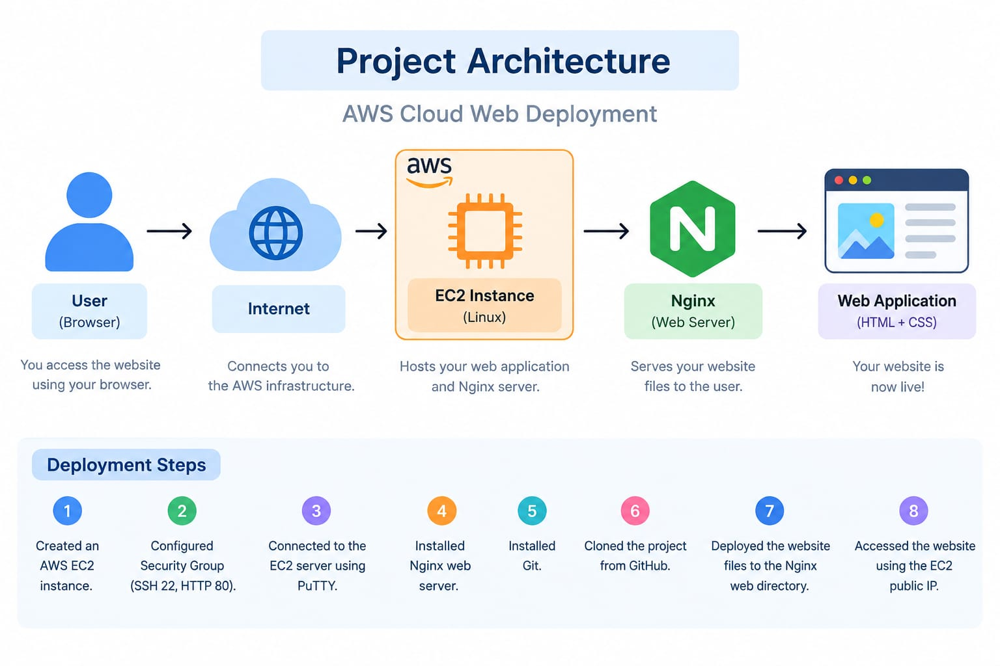

# AWS Cloud Web Deployment

## Project Overview

This project demonstrates how to deploy and host a static website on an AWS EC2 instance using Linux, Nginx, HTML, and CSS.

The website is served through Nginx on an EC2 virtual server, making it accessible through the instance's public IP address when the server is running and correctly configured.

## Architecture



**Request flow:** User → Internet → AWS EC2 → Nginx → Website

## Technologies Used

- **AWS EC2:** Cloud virtual server for hosting the website
- **Amazon Linux:** Server operating system
- **Nginx:** Web server that serves the website files
- **HTML5:** Website structure and content
- **CSS3:** Website styling and responsive layout
- **Git & GitHub:** Source code version control and project hosting

## Project Features

- Hosted a static website on an AWS EC2 instance
- Configured Nginx to serve website files
- Created a responsive layout using HTML and CSS
- Managed project files using Git and GitHub
- Tested the web server using HTTP requests

## Deployment Steps

1. Launch an EC2 instance with Amazon Linux.
2. Configure the required inbound HTTP rule in the EC2 Security Group.
3. Connect to the instance using SSH or PuTTY.
4. Install Nginx and start the service.

   ```bash
   sudo yum install nginx -y
   sudo systemctl enable --now nginx
   ```

5. Copy the website files into the Nginx web root:

   ```bash
   sudo cp index.html /usr/share/nginx/html/
   sudo cp style.css /usr/share/nginx/html/
   ```

6. Test the web server:

   ```bash
   curl -I http://localhost
   ```

7. Open the EC2 public IP address in a browser to verify the website.

## Project Files

- `index.html` — Website structure and content
- `style.css` — Website styling
- `aws-cloud-architecture.png` — Architecture diagram
- `README.md` — Project documentation

## Key Learnings

- Basic AWS EC2 instance management
- Linux commands and service management
- Nginx installation and configuration
- Hosting a static website on a cloud server
- Version control using Git and GitHub

## Repository

[View Source Code on GitHub](https://github.com/nandini-cloudops/aws-cloud-web-deployment)

## Author

Cloud & DevOps learner
